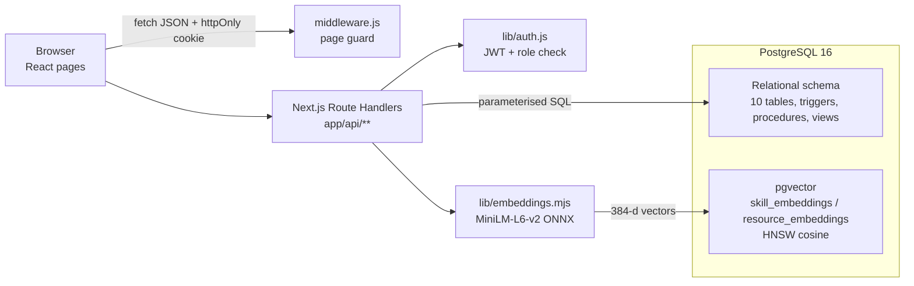

# SkillSwap Campus

**A peer-to-peer skill exchange and resource sharing platform for university campuses.**
Students teach what they know, learn what they don't, pay for it with campus credits, and lend each other the things sitting idle in their rooms.

DBMS Experiential Learning, Level 3 mini project, PES University.
**SQL + Vector Database option:** PostgreSQL 16 + pgvector, with a Next.js 15 web application.

| Team member | SRN |
|---|---|
| Harsh Mannan | PES2UG24CS183 |
| Chirag Arun Yadwad | PES2UG24CS136 |

---

## What it does

| Area | Features | Database concepts behind it |
|---|---|---|
| **Skill marketplace** | List skills you teach / want to learn; search in your own words | pgvector embeddings, HNSW index, full-text search (GIN), hybrid ranking (Reciprocal Rank Fusion) |
| **Matchmaking** | "Perfect swaps" (mutual matches) and semantic tutor recommendations | 4-way self-join; `LATERAL` k-NN join |
| **Sessions** | Book, confirm, complete, cancel, review | Stored procedure, state-machine trigger, GiST `EXCLUDE` constraints (no double booking), row locks |
| **Credit economy** | 10 credits per hour; balance + full ledger | Settlement trigger (atomic, deadlock-safe), reconciliation view, window functions |
| **Resource lending** | List items, request, approve, return | `daterange` exclusion constraint, multi-statement transaction, sync trigger |
| **Notifications** | Bell with unread count | `AFTER` triggers writing inside the same transaction |
| **Admin / staff** | Analytics dashboard, user management, catalogue, **DB Lab** (live test suite + query runner + read-only SQL console) | `GROUP BY / HAVING`, CTEs, views, `RANK()`, `EXPLAIN ANALYZE`, system catalogue |

Roles: **student**, **staff** (read-only admin views), **admin** (full control). Enforced on every API route and again in page middleware.

## Tech stack and why

| Layer | Choice | Why |
|---|---|---|
| Relational DB | **PostgreSQL 16** | Credits, bookings and loans need ACID transactions, foreign keys, CHECK/EXCLUDE constraints and triggers. A half-applied credit transfer would corrupt the economy. |
| Vector DB | **pgvector** (in the same Postgres) | Skill and item descriptions are free text. Students describe needs in their own words ("help with regression for my thesis"), so keyword search misses relevant tutors. Embeddings capture meaning. Keeping vectors next to the relational rows lets one SQL query join similarity scores with ratings, filters and availability, with foreign keys and cascades keeping vectors consistent. |
| Embeddings | **all-MiniLM-L6-v2** (384-d, ONNX, quantised) via Transformers.js | Runs locally inside Node: no API key, no cost, works offline, and student data never leaves the server. The model is vendored in `models/`. |
| Web app | **Next.js 15** (App Router) + React 19 | The UI plus the API layer (Route Handlers) in one project. |
| DB driver | `pg` (node-postgres), raw parameterised SQL | Every query is visible and explainable; no ORM hides the SQL. |
| Auth | bcrypt + signed JWT in an httpOnly cookie (`jose`) | No plain-text passwords, no token readable by page scripts. |

## Architecture



## Setup

**Quick start for presenting (Windows + Neon): see [`START_HERE.md`](START_HERE.md).**

You need **Node.js 18.18+** and a **PostgreSQL 14+ with the pgvector extension**. Pick one of the three database options.

### 1. Install

```bash
git clone <repo-url> skillswap-campus
cd skillswap-campus
npm install
```

### 2. Database (choose ONE)

**Option A: Docker (easiest)**
```bash
docker compose up -d          # pgvector/pgvector:pg16 on localhost:5433
```
The default `DATABASE_URL` in `.env.example` already points here.

**Option B: PostgreSQL already installed on your laptop**
- macOS: `brew install pgvector`
- Ubuntu/Debian: `sudo apt install postgresql-16-pgvector`
- Windows: pgvector has to be compiled ([instructions](https://github.com/pgvector/pgvector#windows)). Option A or C is much easier.

Then set `DATABASE_URL=postgres://postgres:<your-password>@localhost:5432/skillswap_campus` in `.env.local`.
The setup script creates the database if it does not exist. If your user is not a superuser, first run `CREATE EXTENSION vector;` as `postgres` inside that database.

**Option C: Neon (free cloud Postgres, nothing to install)**
Create a project at neon.tech and copy its connection string (it includes `?sslmode=require`) into `DATABASE_URL`. `vector` and `btree_gist` are both available there.

### 3. Configure

```bash
cp .env.example .env.local    # then edit DATABASE_URL / JWT_SECRET if needed
```
If you skip this step, `npm run db:setup` creates `.env.local` for you with a random `JWT_SECRET`.
**No credentials are hard-coded anywhere in the source.** All configuration comes from environment variables, and `.env.local` is git-ignored.

### 4. Build the database and run

```bash
npm run db:setup   # schema + migrations + logic + vector layer + demo data + embeddings (~5 s)
npm run dev        # http://localhost:3000
```

`npm run db:setup` can be re-run at any time to reset to clean demo data. **Run it shortly before a demo**, because the demo bookings are scheduled relative to "now".

### Demo accounts (password `Password@123`)

| Role | E-mail |
|---|---|
| Admin | `admin@campus.edu` |
| Staff | `ramesh.iyer@campus.edu` |
| Student | `harsh@campus.edu` |
| Student | `chirag@campus.edu` |
| Other students | `ananya@`, `rohan@`, `priya@`, `ishita@`, `neha@`, `karthik@` … `@campus.edu` |

The login page has one-click buttons for the first four.

## Scripts

| Command | What it does |
|---|---|
| `npm run dev` | Development server on port 3000 |
| `npm run build` / `npm start` | Production build / server |
| `npm run db:setup` | (Re)build the whole database with demo data and embeddings |
| `npm run db:embed` | Embed any listing that has no vector yet |
| `npm run db:test` | **Database integrity suite**: 24 attacks and checks, all rolled back |
| `npm run test:api` | **End-to-end API test**: 51 checks over HTTP (needs the server running; it changes demo data, so re-run `db:setup` after) |

## Database files (run in this order by `db:setup`)

| File | Contents |
|---|---|
| `db/01_schema.sql` | Week 4 schema v2: 10 tables, PK/FK, CHECK, GiST EXCLUDE, 16 indexes, 2 views, 5 triggers, procedure, FTS function |
| `db/02_migrations.sql` | v3 **ALTER / DROP** migrations: new columns, DB-level validation constraints, expression unique index, dropping a redundant index |
| `db/03_features.sql` | v3 logic: session state machine, over-booking fix, cross-role clash check, borrow validation, notification triggers, matchmaking function, leaderboard + demand views |
| `db/04_vector.sql` | pgvector layer: embedding tables, HNSW indexes, staleness triggers, semantic / hybrid / recommendation functions |
| `db/05_important_queries.sql` | The 18 showcase queries (JOIN, GROUP BY/HAVING, subqueries, window functions, CTE, k-NN, EXPLAIN …) |
| `db/week4/` | Original Week 4 regression test script |

## Project structure

```
app/
  (app)/            logged-in pages: dashboard, skills, my-skills, sessions, resources, credits, admin/*
  api/              REST API (Route Handlers), one folder per resource
  login, register   public pages
components/         AppShell (sidebar, bell), BookModal, UI helpers
lib/
  db.mjs            connection pool + withTransaction()
  auth.js           bcrypt/JWT session handling
  api.js            route() wrapper: auth, roles, error mapping
  errors.js         PostgreSQL error -> friendly message (keeps SQLSTATE + constraint)
  embeddings.mjs    MiniLM embedding + pgvector helpers
  integrityTests.mjs  the DB test suite (shared by CLI and DB Lab)
  showcase.mjs      the important queries (shared by DB Lab and db/05)
db/                 SQL files (see above)
scripts/            setup, seed, embed, test runners
tests/              end-to-end API test
models/             vendored all-MiniLM-L6-v2 ONNX model (offline)
docs/               ER diagram (Chen), relational schema, report, screenshots
```

## Security

- Passwords are hashed with **bcrypt** (cost 10). A database CHECK constraint (`chk_users_password_is_hash`) rejects anything that is not a bcrypt hash, so a plain-text password cannot be stored even by mistake.
- Sessions are signed JWTs in an **httpOnly, SameSite=Lax** cookie. Role and active status are re-read from the database on every request, so deactivating a user takes effect immediately.
- **All SQL is parameterised** (`$1, $2 …`). The only dynamic identifiers come from a fixed whitelist.
- The admin SQL console runs in a `READ ONLY` transaction with a 5 s timeout over the extended protocol (one statement only), so it cannot write.
- Same error message for a wrong e-mail and a wrong password (no user enumeration).
- Prices are computed on the server; the client cannot choose what a session costs.

## Team contributions

| Area | Harsh Mannan (PES2UG24CS183) | Chirag Arun Yadwad (PES2UG24CS136) |
|---|---|---|
| Relational design | Schema, constraints, Week 4 defect audit | ER diagram, data dictionary |
| Database logic | Credit settlement trigger + deadlock fix, reconciliation view, booking procedure, state machine, cross-role clash check | Borrow validation, notification triggers, leaderboard and demand views, matchmaking function |
| Vector database | Query embedding in the search API | pgvector tables, HNSW indexes, embedding pipeline, semantic / hybrid / recommendation functions |
| Transactions | Booking and bonus-grant transactions | Loan-approval transaction |
| Application | Auth, roles, API layer; dashboard, sessions, credits pages | Search, my-skills, resources pages; analytics, users, catalogue, DB Lab |
| Testing and docs | API test suite, README, demo script | Integrity test suite, important queries, report, screenshots |

Both members worked on the database **and** the application, as the project brief requires.

## Documentation

- `docs/SkillSwap_Campus_Final_Report.docx` / `.pdf`: final project report in the PES University template
- `docs/er_diagram_chen.png` / `.pdf`: ER diagram in Chen notation (source: `docs/report_assets/er_chen.py`)
- `docs/relational_schema.png`: relational schema after ER-to-relational mapping
- `docs/report_assets/`: scripts that regenerate every report image and the report itself
- `docs/screenshots/`: application screenshots
- `DEMO_GUIDE.md`: demo script and viva questions

---
Built for the DBMS Level 3 project, PES University, 2026.
